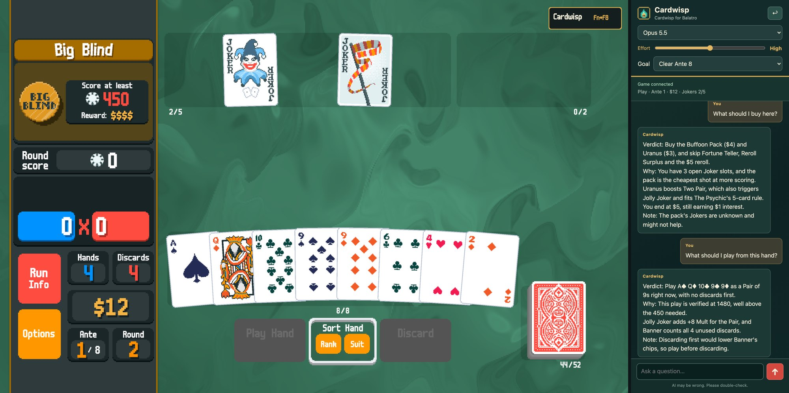
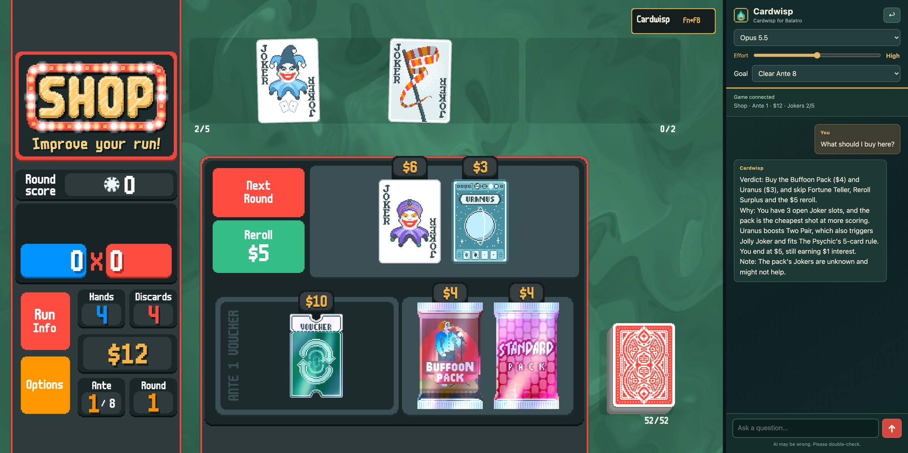
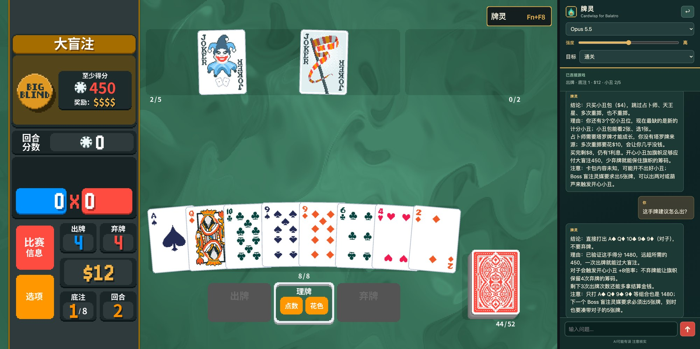
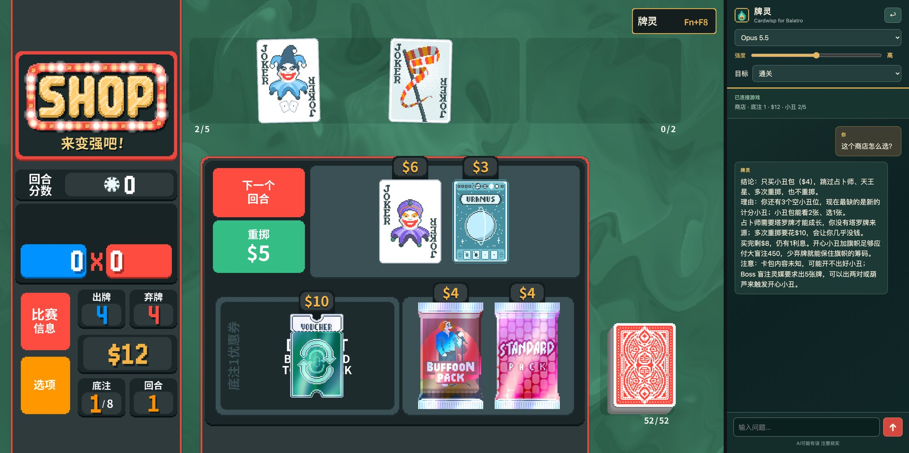

<p align="center">
  
</p>

<h1 align="center">Cardwisp for Balatro · 小丑牌灵</h1>

<p align="center">
  <b>An AI advisor mod for Balatro: it reads what is on screen and suggests what to buy, pick and play.</b><br>
  Balatro（小丑牌）AI 顾问模组：读取当前局面，建议买什么、选什么、怎么出牌。
</p>

<p align="center">
  <a href="https://github.com/AxisXu/Cardwisp-for-Balatro/releases/latest"></a>
  <a href="LICENSE"></a>
  
  
</p>

<p align="center"><a href="#english"><b>English</b></a> · <a href="#中文说明"><b>中文说明</b></a></p>

---

## English

Cardwisp is an AI advisor that lives inside Balatro. Open the panel during a run, ask a question (or send the suggested one), and get short advice based on what is currently on screen. **It only reads the visible game state and gives text advice. It never plays cards, buys items, or takes any action for you.**



<sub>Playing a hand: Cardwisp lists the verified score (1,480 vs. 450 needed) and explains why to play before discarding. The advice is in the companion window on the right.</sub>

### How it works

1. **The game shares only what you can see.** The mod reads the visible state (your hand, Jokers, shop, blind, money) and sends it to a small bridge program on your own computer. Nothing leaves your machine yet.
2. **You ask.** Each scene has a suggested question, such as *What should I buy here?*, or you can type your own.
3. **The bridge checks the numbers first.** Before asking the model, it works out the facts it can verify: costs, money left after buying, interest tiers, Joker slots, score still needed, and the exact final score of every play it can verify.
4. **Your AI model answers.** The bridge sends the state, the checked facts and your question to the model, and the advice appears in the in-game panel or the companion window.



<sub>In the shop: costs, interest and open Joker slots are worked out before the model answers.</sub>

### Tested results

To check whether the advice actually helps, we let a test harness follow Cardwisp's advice for every decision in a full run, on a separate copy of the game.

| Setup | Result |
| --- | --- |
| Red Deck, White Stake, Opus 5.5 (high effort), 10 fixed seeds | **Won 7 of 10 runs** (beat Ante 8). The other three ended at Ante 8, 7 and 6. Average: Ante 8.4. |
| Verified scores | Every play we could check against the game (22 of 22) scored exactly as Cardwisp listed. |
| Waiting time | About 12 seconds per answer (median). 90% of answers arrive within 17 seconds. |

- Rules followed in every test: no restarting runs, no rerolling seeds, and no hidden information (face-down cards, pack contents, draw order).
- Seven of the ten runs used an earlier test build with the same score checker and a fuller game state. The other three used the released version and won all three. The released version also won 5 of the 6 runs it played across all tests.
- White Stake is the lowest difficulty, and ten runs is a small sample. Higher stakes and other models have not been tested.
- In normal use Cardwisp never plays for you. The harness was only used for testing.

### Features

- **In-game chat panel.** Click **Cardwisp** in the top-right corner or press **F8** (Fn + F8 on a Mac keyboard). Drag the left edge to resize it.
- **Scene-aware questions.** The shop, booster packs, playing a hand, and blind selection each get a suggested question. Send it as is or type your own.
- **Checked numbers instead of guesses.** In the shop that means costs, the balance left after buying, interest tiers, Joker slots, and sell-then-buy swaps. When playing a hand it means the score still needed, hands and discards left, and **exact final scores for the hands that can be verified**.
- **Follows the game language.** The interface is available in English and Simplified Chinese; other languages fall back to English. Card names and effects are read in the game's own language.
- **Optional companion window on macOS.** Advice can be shown in a separate window docked next to the game instead of inside it.

### Requirements

- **Balatro for PC/Mac (Steam).** Mobile, console and Apple Arcade versions cannot load mods.
- **[Lovely](https://github.com/ethangreen-dev/lovely-injector)** and **[Steamodded](https://github.com/Steamodded/smods)** 1.0.0~BETA-0301a or newer.
- **Python 3.9 or newer**, to run the local bridge.
- **An AI model.** The recommended setup is **[Claude Code](https://claude.com/claude-code)** installed and signed in (run `claude` once in a terminal to log in). It works with a Claude subscription or with an `ANTHROPIC_API_KEY`, and each question counts toward that account's usage. Other models, such as OpenAI, DeepSeek, StepFun or a local model, can be added through any OpenAI-compatible API. See [Using other AI models](#using-other-ai-models).
- For the macOS companion window: Xcode Command Line Tools (`swiftc`). It is compiled on first use.

Cardwisp is developed and tested on macOS. The in-game panel and the bridge are plain Lua and Python and should work on Windows too, but Windows has not been tested yet.

### Install

1. Download `Cardwisp-<version>.zip` from [Releases](https://github.com/AxisXu/Cardwisp-for-Balatro/releases/latest) and unzip it anywhere.
2. Install the mod into your Balatro `Mods` folder:

   ```sh
   python3 scripts/install.py --mods-dir "<your Balatro Mods folder>"
   ```

   The `Mods` folder is usually `~/Library/Application Support/Balatro/Mods` on macOS and `%AppData%\Balatro\Mods` on Windows. The script copies only the mod's own files. If an older version exists, it is backed up to `assistant-backups/` next to the `Mods` folder first. It never touches other mods, the game itself, or your saves.

   You can also copy `main.lua`, `balatro-assistant.json`, `modules/`, `locales/` and `LICENSE` into `Mods/balatro-assistant/` by hand.

3. Start the bridge and keep its window open while you play:

   ```sh
   python3 scripts/cli_bridge.py
   ```

   On macOS you can double-click `scripts/start_bridge.command` instead.

4. Start the game with mods enabled. **On macOS, launch it with `run_lovely_macos.sh` in the game folder.** The Steam Play button does not load Lovely there. On Windows, Lovely loads when you start the game from Steam as usual.

To uninstall, delete `Mods/balatro-assistant/`.

### Usage

- Open or close the panel with the **Cardwisp** button or **F8**. Press Enter to send and Esc to leave the input box. Chinese and other IME input is supported; finish composing before pressing Enter.
- The icons at the top right of the panel are, from left to right: **settings** (model and thinking effort), **move to a separate window** (the companion window), and **collapse**. Without the bridge, settings and the separate window are greyed out. Hover over an icon to see what it does. Settings take effect from the next question.
- If the game state changes while the model is answering, the answer is discarded and you are asked to try again, so you never get advice for a state that no longer exists.
- Chat history lives in the bridge's memory and is cleared when a new run starts or the bridge stops.

### Using other AI models

Cardwisp can reach a model in two ways.

**1. Through the bridge (recommended, all features).** The game always talks to the bridge, and the bridge calls the model. You get the checked numbers, verified scores, the model and effort settings, and the companion window. The bridge can call:

- **Claude through the Claude Code CLI**, with your own account. Opus 5.5 and Fable 5.1 are listed by default.
- **Any OpenAI-compatible API**: OpenAI, DeepSeek, StepFun, OpenRouter, or a local server such as Ollama or LM Studio. Create `models.json` in the Cardwisp settings folder (`~/Library/Application Support/Cardwisp/` on macOS, `%AppData%\Cardwisp\` on Windows):

  ```json
  {
    "models": [
      {
        "name": "My Model",
        "model": "your-model-name",
        "url": "https://api.example.com/v1/chat/completions",
        "api_key_env": "MY_MODEL_API_KEY"
      }
    ]
  }
  ```

  Restart the bridge. It prints `Extra models: ...`, and the model appears in the settings menu next to Opus and Fable. If Claude Code is not installed, the first model in this file becomes the default.

  - `name` is the label in the settings menu. Keep it short.
  - `url` must be `https://`, or `http://` on `localhost` / `127.0.0.1`. For Ollama, use `http://127.0.0.1:11434/v1/chat/completions` and leave out the key.
  - The key: `api_key_env` names an environment variable that holds it (safer). Alternatively, `"api_key": "..."` stores it in plain text in this file.
  - Optional: `"efforts": ["low", "medium", "high"]` adds effort levels, sent as `reasoning_effort`. Only use this if the model supports that parameter. Without it, the model has a single "Default" level.
  - Optional: `"timeout_seconds"` from 10 to 300 (default 120). At most 4 models.
  - If you used the direct connection below before, delete `cardwisp-model.json` from the Balatro save folder. Otherwise the game keeps bypassing the bridge.

**2. Direct connection from the game (basic advice, no bridge).** Use this only if you can't run the bridge. Option 1 gives you every feature with the same models. In this mode the settings and separate-window icons stay greyed out. This works with OpenAI, DeepSeek, OpenRouter, or a local server such as Ollama or LM Studio. Create `cardwisp-model.json` in the Balatro save folder (`~/Library/Application Support/Balatro/` on macOS, `%AppData%\Balatro\` on Windows):

```json
{
  "url": "https://api.example.com/v1/chat/completions",
  "model": "your-model-name",
  "api_key": "your-key",
  "timeout_seconds": 120
}
```

- `url` must be `https://`, or `http://` on `localhost` / `127.0.0.1`. For Ollama, use `http://127.0.0.1:11434/v1/chat/completions` and leave out `api_key`.
- `timeout_seconds` can be 10 to 300 (default 45).
- While this file exists, the game talks to that server directly and the bridge is not used. You get advice from the visible state, but **no checked numbers, verified scores, settings menu or companion window**. To keep those, add the same model to the bridge's `models.json` instead (option 1).
- The key is stored in plain text in that file on your computer. Use a key with a spending limit, and never share the file.
- Delete the file to go back to the bridge.

`model.example.json` in this folder is a minimal example for a local server.

### Privacy and cost

- The game syncs the visible state to the bridge on your own computer (`127.0.0.1:8765`) about once a second. **Nothing is sent to a model until you ask a question.**
- Each question sends the visible state, the checked facts, your question and up to eight recent chat messages to the model you chose. No other data is collected.
- Hidden information stays hidden: face-down cards, unopened packs and the draw order are never read.
- With Claude Code, Cardwisp does not store or ask for API keys; the Claude Code CLI uses your own sign-in.
- A key you put in `models.json` stays on your computer and is only sent to that model's `url`.

### Limitations

- Advice comes from a language model and can be wrong. Treat it as a second opinion.
- Exact scores are only listed when every effect involved can be verified. They are left out when face-down cards are in hand, for Bosses that change scoring (such as The Flint), and for some Jokers. An unlisted play is not necessarily worse.
- Some dynamic card text that cannot be resolved from the visible state is shown as `?`, and the model is told the value is unknown.
- Built for mouse and keyboard on desktop. Controllers and touch screens are not supported.

### FAQ

**Does Cardwisp play Balatro for me?**
No. It only reads the visible state and writes advice. You make every move yourself.

**Which AI models can I use?**
Claude (Opus 5.5 or Fable 5.1) through Claude Code gets every feature. Any OpenAI-compatible API, including local models, can be added to the bridge with the same features, or connected directly for basic advice. See [Using other AI models](#using-other-ai-models).

**Is the advice any good?**
Following Cardwisp's advice for every decision won 7 of 10 runs on White Stake. See [Tested results](#tested-results). It can still be wrong, so treat it as a second opinion.

**How long does an answer take?**
Usually 10 to 20 seconds, with a median of about 12. Complicated situations occasionally take around 40 seconds.

**Is it free?**
The mod is free and open source under the MIT License. Questions count toward your own AI account's usage or API bill.

**Can it see my next cards or what is inside a pack?**
No. Face-down cards, unopened packs and the draw order are never read.

**Does it work on mobile, Switch or Apple Arcade?**
No. Only the Steam version for PC/Mac can load mods.

**Does it change my save?**
No. It only reads the game state. The install script only copies the mod's own files.

### Development

```sh
python3 tests/run_all.py
```

The Lua tests use the LuaJIT library bundled with Steam Balatro on macOS. Set `BALATRO_LUA_LIBRARY` to point at another Lua 5.1/LuaJIT library. The tests never start or change a run.

Layout:
- `modules/core.lua`: reads the game state.
- `modules/panel.lua`: in-game panel.
- `modules/model.lua`: talks to the bridge or a direct model server.
- `scripts/cli_bridge.py`: shared session, prompts and the model CLIs.
- `scripts/shop_decision.py`, `scripts/scene_decision.py` and `scripts/play_scores.py` with `scripts/hand_score.py`: the checked bookkeeping and the scorer.
- `scripts/CardwispCompanion.swift` and `companion/index.html`: the macOS window.

Design notes and known issues are in `docs/` (in Chinese).

### License

Released under the [MIT License](LICENSE). The license covers Cardwisp's own code and documents only. Balatro, Steamodded, Lovely and other mods are not covered, and Cardwisp contains no game assets. The screenshots show Balatro gameplay for illustration only; the game's art belongs to its owners. Cardwisp is a fan-made mod and is not affiliated with or endorsed by LocalThunk or Playstack.

---

## 中文说明

小丑牌灵是装在 Balatro（小丑牌）里的 AI 顾问。牌局中打开面板，提个问题（或直接发送预填的问题），就能根据当前屏幕上的局面得到简短建议。**它只读取可见局面、给出文字建议，绝不替你出牌、买东西或执行任何操作。**



<sub>出牌时：牌灵列出已验证的得分（1480 对比所需 450），并解释为什么先出牌、不弃牌。右侧是 macOS 独立窗口。</sub>

### 工作原理

1. **游戏只分享你看得到的东西。** 模组读取可见局面（手牌、小丑、商店、盲注、金钱），发给**你自己电脑上**的桥接程序。这一步不会有任何数据离开你的电脑。
2. **你提问。** 每个场景都有预填问题，比如「这个商店怎么选？」，也可以自己输入。
3. **桥接程序先核对数字。** 问模型之前，先算好能确定的事实：价格、买完剩多少钱、利息档位、小丑格子、还差多少分，以及每种能确定的出牌组合的精确最终得分。
4. **你的 AI 模型回答。** 桥接程序把局面、核对过的数据和你的问题一起发给模型，建议显示在游戏内面板或独立窗口里。



<sub>商店里：价格、利息和空余小丑格子在模型回答前就已经算好。</sub>

### 实测表现

为了检验建议是不是真的有用，我们在一份单独的游戏副本上让测试程序整局照牌灵的建议走，每个决定都听它的。

| 测试条件 | 结果 |
| --- | --- |
| 红色牌组、白色赌注、Opus 5.5（高思考强度）、10 个固定种子 | **10 局通关 7 局**（打过第 8 底注），另外三局止步第 8、7、6 底注，平均打到第 8.4 底注 |
| 已验证得分 | 能对照游戏实际结果核对的出牌共 22 手，得分与牌灵列出的完全一致 |
| 等待时间 | 每次回答中位约 12 秒，90% 在 17 秒内 |

- 全程遵守：不重开、不换种子、不读隐藏信息（背面朝下的牌、卡包内容、抽牌顺序）。
- 10 局里有 7 局用的是更早的测试版本，计分核对相同、局面信息更全；另外 3 局用的是发布版，3 局全部通关。把所有测试算在一起，发布版打过 6 局，通关 5 局。
- 白色赌注是最低难度，10 局样本也不大；更高赌注和其他模型还没测过。
- 平时使用时牌灵不会替你操作，测试程序只用于测试。

### 功能

- **游戏内聊天面板。** 点右上角「牌灵」或按 **F8**（Mac 键盘为 Fn + F8）打开。拖动面板左边缘可以调宽度。
- **按场景预填问题。** 商店、开卡包、出牌、选盲注各有预填问题，可以直接发送，也可以自己改写。
- **核对过的数字，不靠模型猜。** 商店里是价格、买完剩多少钱、利息档位、小丑格子、卖旧买新的账目；出牌时是还差多少分、剩几手几弃，以及**能确定的出牌组合的精确最终得分**。
- **跟随游戏语言。** 界面有简体中文和英语，其他语言回退英语；卡牌名称和效果按游戏自己的语言读取。
- **macOS 可选独立窗口。** 建议可以显示在停靠游戏旁边的独立窗口里，而不是游戏画面内。

### 运行要求

- **电脑版 Balatro（Steam）。** 手机版、主机版和 Apple Arcade 版都不能装模组。
- **[Lovely](https://github.com/ethangreen-dev/lovely-injector)** 和 **[Steamodded](https://github.com/Steamodded/smods)** 1.0.0~BETA-0301a 或更新版本。
- **Python 3.9 或更新版本**，用于运行本机桥接程序。
- **一个 AI 模型。** 推荐安装并登录 **[Claude Code](https://claude.com/claude-code)**（在终端运行一次 `claude` 完成登录）。Claude 订阅或 `ANTHROPIC_API_KEY` 都可以，每次提问计入该账号的用量。OpenAI、DeepSeek、阶跃星辰或本地模型等，可以通过任意 OpenAI 兼容接口接入，见[接入其他 AI 模型](#接入其他-ai-模型)。
- 使用 macOS 独立窗口需要 Xcode 命令行工具（`swiftc`），首次使用时自动编译。

牌灵在 macOS 上开发和测试。游戏内面板和桥接程序都是普通的 Lua 与 Python，理论上也能在 Windows 上运行，但还没在 Windows 上测试过。

### 安装

1. 从 [Releases](https://github.com/AxisXu/Cardwisp-for-Balatro/releases/latest) 下载 `Cardwisp-<版本号>.zip`，解压到任意位置。
2. 把模组装进 Balatro 的 `Mods` 文件夹：

   ```sh
   python3 scripts/install.py --mods-dir "<你的 Balatro Mods 文件夹>"
   ```

   `Mods` 文件夹通常在：macOS 是 `~/Library/Application Support/Balatro/Mods`，Windows 是 `%AppData%\Balatro\Mods`。脚本只复制本模组自己的文件；已有旧版本时，先备份到 `Mods` 旁边的 `assistant-backups/`。它不会改动其他模组、游戏本身和存档。

   也可以手动把 `main.lua`、`balatro-assistant.json`、`modules/`、`locales/` 和 `LICENSE` 复制到 `Mods/balatro-assistant/`。

3. 启动桥接程序，玩的时候保持它的窗口开着：

   ```sh
   python3 scripts/cli_bridge.py
   ```

   macOS 上也可以直接双击 `scripts/start_bridge.command`。

4. 以启用模组的方式启动游戏。**macOS 上请用游戏目录里的 `run_lovely_macos.sh` 启动**，Steam 的「开始游戏」按钮不会加载 Lovely。Windows 上照常从 Steam 启动即可，Lovely 会自动生效。

卸载：删除 `Mods/balatro-assistant/`。

### 使用

- 用「牌灵」按钮或 **F8** 打开、收起面板。Enter 发送，Esc 离开输入框。支持中文等输入法，选完词再按 Enter。
- 面板右上角的图标从左到右是：**设置**（模型与思考强度）、**移到游戏外的独立窗口**、**收起**。鼠标移到图标上会显示用途。没有桥接程序时，设置和独立窗口会置灰。设置从下一次提问起生效。
- 模型回答期间局面一旦变化，旧回答会被丢弃并提示重新提问，不会拿过时的局面给你建议。
- 聊天记录只保存在桥接程序的内存里，开新局或关闭桥接程序后清空。

### 接入其他 AI 模型

牌灵有两种方式连接模型。

**1. 通过桥接程序（推荐，功能完整）。** 游戏始终连桥接程序，由桥接程序调用模型。核对数据、已验证得分、模型与强度设置、独立窗口全部可用。桥接程序可以调用：

- **Claude**：通过 Claude Code 命令行，用你自己的账号。默认列出 Opus 5.5 和 Fable 5.1。
- **任意 OpenAI 兼容接口**：OpenAI、DeepSeek、阶跃星辰、OpenRouter，以及 Ollama、LM Studio 等本地模型服务。在牌灵设置文件夹（macOS 是 `~/Library/Application Support/Cardwisp/`，Windows 是 `%AppData%\Cardwisp\`）里新建 `models.json`：

  ```json
  {
    "models": [
      {
        "name": "我的模型",
        "model": "your-model-name",
        "url": "https://api.example.com/v1/chat/completions",
        "api_key_env": "MY_MODEL_API_KEY"
      }
    ]
  }
  ```

  重启桥接程序，它会打印「额外模型：…」，设置菜单里就会在 Opus、Fable 旁边多出这个模型。没装 Claude Code 时，默认使用文件里的第一个模型。

  - `name` 是设置菜单里显示的名字，尽量短。
  - `url` 必须是 `https://`，或者指向 `localhost` / `127.0.0.1` 的 `http://`。用 Ollama 时填 `http://127.0.0.1:11434/v1/chat/completions`，不用写密钥。
  - 密钥：`api_key_env` 填保存密钥的环境变量名（更安全）；也可以写 `"api_key": "..."`，以明文保存在这个文件里。
  - 可选 `"efforts": ["low", "medium", "high"]`：加上强度档位，以 `reasoning_effort` 参数发送。模型支持这个参数才加。不写时只有「默认」一档。
  - 可选 `"timeout_seconds"`：10 到 300，默认 120。最多 4 个模型。
  - 如果之前用过下面的直连方式，请删掉 Balatro 存档文件夹里的 `cardwisp-model.json`，否则游戏会继续绕过桥接程序。

**2. 游戏直连（基础建议，不经过桥接程序）。** 只在无法运行桥接程序时使用；方式 1 能用同样的模型并保留全部功能。这种方式下，设置和独立窗口两个图标会保持置灰。OpenAI、DeepSeek、OpenRouter，以及 Ollama、LM Studio 等本地模型服务都可以。在 Balatro 存档文件夹（macOS 是 `~/Library/Application Support/Balatro/`，Windows 是 `%AppData%\Balatro\`）里新建 `cardwisp-model.json`：

```json
{
  "url": "https://api.example.com/v1/chat/completions",
  "model": "your-model-name",
  "api_key": "your-key",
  "timeout_seconds": 120
}
```

- `url` 必须是 `https://`，或者指向 `localhost` / `127.0.0.1` 的 `http://`。用 Ollama 时填 `http://127.0.0.1:11434/v1/chat/completions`，不用写 `api_key`。
- `timeout_seconds` 可填 10 到 300，默认 45。
- 这个文件存在时，游戏直接连这个服务，不经过桥接程序。你能得到基于可见局面的建议，但**没有核对数据、已验证得分、设置菜单和独立窗口**。想保留这些功能，就把同一个模型写进桥接程序的 `models.json`（方式 1）。
- 密钥以明文保存在你电脑上的这个文件里。请使用设了消费上限的密钥，也不要把文件发给别人。
- 删除这个文件即可回到桥接程序。

本文件夹里的 `model.example.json` 是连接本地模型服务的最简示例。

### 隐私与费用

- 游戏每秒把可见局面同步给**你自己电脑上**的桥接程序（`127.0.0.1:8765`）。**你不提问，就不会有任何内容发给模型。**
- 每次提问会把可见局面、核对过的数据、你的问题和最多八条近期对话发给你选的模型。除此之外不收集任何数据。
- 隐藏信息不会被读取：背面朝下的牌、没打开的卡包和抽牌顺序都看不到。
- 使用 Claude Code 时，牌灵不保存也不索要 API 密钥，Claude Code 命令行使用你自己的登录。
- 写进 `models.json` 的密钥只保存在你的电脑上，只会发给该模型的 `url`。

### 已知限制

- 建议来自语言模型，可能出错，请当作参考意见。
- 只有涉及的每个效果都能确认时，才会列出精确得分。手里有背面朝下的牌、遇到会改变计分的 Boss（如燧石）、或者有部分小丑在场时，不会列出得分。没列出的出牌不代表分数更低。
- 少数卡面动态数值无法从可见局面确定时，会显示为 `?`，模型也会被告知该数值未知。
- 为桌面键鼠设计，不支持手柄和触屏。

### 常见问题

**牌灵会替我打 Balatro 吗？**
不会。它只读取可见局面、写出建议，每一步都由你自己操作。

**能用哪些 AI 模型？**
通过 Claude Code 使用 Claude（Opus 5.5 或 Fable 5.1）功能最完整。任何 OpenAI 兼容接口（包括本地模型）都可以接进桥接程序，功能相同；也可以直连，只给基础建议。见[接入其他 AI 模型](#接入其他-ai-模型)。

**建议靠谱吗？**
照牌灵的建议整局打下来，白色赌注 10 局通关 7 局，见[实测表现](#实测表现)。它仍然会出错，请当作参考意见。

**一次回答要等多久？**
通常 10 到 20 秒，中位约 12 秒。局面复杂时偶尔会到 40 秒左右。

**收费吗？**
模组本身免费，以 MIT 许可证开源。提问会计入你自己 AI 账号的用量或 API 账单。

**它能看到下一张牌或卡包里的内容吗？**
不能。背面朝下的牌、没打开的卡包和抽牌顺序都不会被读取。

**手机版、Switch 或 Apple Arcade 版能用吗？**
不能。只有电脑上的 Steam 版能装模组。

**会改动我的存档吗？**
不会。它只读取游戏局面，安装脚本也只复制本模组自己的文件。

### 开发

```sh
python3 tests/run_all.py
```

Lua 测试在 macOS 上使用 Steam 版 Balatro 自带的 LuaJIT 库；其他位置可用 `BALATRO_LUA_LIBRARY` 指定兼容 Lua 5.1/LuaJIT 的库。测试不会启动或改动牌局。

代码结构：
- `modules/core.lua`：读取局面。
- `modules/panel.lua`：游戏内面板。
- `modules/model.lua`：与桥接程序或直连的模型服务通信。
- `scripts/cli_bridge.py`：共享会话、提示词和模型命令行调用。
- `scripts/shop_decision.py`、`scripts/scene_decision.py`，以及 `scripts/play_scores.py` 配合 `scripts/hand_score.py`：核对数据和计分器。
- `scripts/CardwispCompanion.swift` 与 `companion/index.html`：macOS 独立窗口。

设计说明与已知问题见 `docs/`。

### 许可证

以 [MIT 许可证](LICENSE)发布。许可证只覆盖牌灵自己的代码与文档；Balatro 游戏本身、Steamodded、Lovely 及其他模组不在此列，牌灵也不包含任何游戏资源。截图展示的 Balatro 游戏画面仅作说明用途，美术版权归游戏权利方所有。牌灵是玩家自制模组，与 LocalThunk、Playstack 没有关联，也未获其认可。
